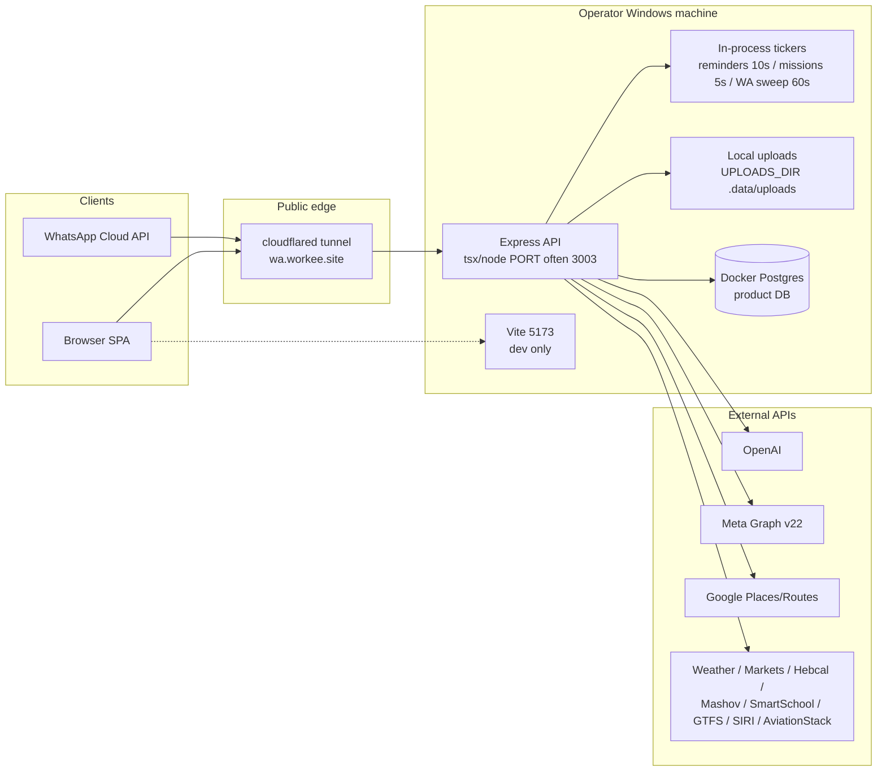
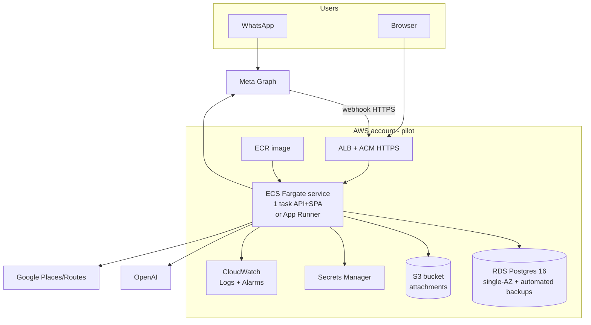

# Lucy Infrastructure Discovery

**Workstream:** Infrastructure Discovery (assessment only)  
**Scope:** Official1 / Workee · ~20-user cloud pilot  
**Date:** 2026-11-14  
**Status:** Discovery complete — no implementation, migration, or deploy performed  

Legend used below:

| Tag | Meaning |
|-----|---------|
| **Verified** | Supported by repository files, scripts, or docs in this checkout |
| **Assumption** | Reasonable inference; not proven from committed config alone |
| **Unknown** | Needs your input before architecture lock-in |
| **Recommendation** | Proposed target — not currently deployed |

---

## 1. Executive summary

**Verified:** Lucy today runs as a **single-machine pilot**: Node Express API + React SPA (built into the API for public serving), **Docker Postgres**, **local disk uploads**, and **in-process timers** for reminders, missions, and WhatsApp submission sweep. Public HTTPS is provided by a **Cloudflare tunnel** (`wa.workee.site`) to the laptop, not by AWS.

**Main gaps for a 20-user cloud pilot:** no always-on host independent of a personal PC; no managed backups/restore runbook; attachments are local filesystem only; background work dies if the API process dies; observability is mostly `console.log` + a trivial health check; secrets live in a gitignored `.env` on disk.

**Recommendation:** Start with a **small AWS footprint** — one containerized API (ECS Fargate or App Runner), **RDS Postgres**, **S3** for attachments, **Secrets Manager**, ALB + HTTPS, CloudWatch logs/alarms, and keep WhatsApp webhooks pointed at the cloud URL. Defer multi-AZ complexity, Kubernetes, and separate worker fleets until load or reliability needs justify them.

---

## 2. Current architecture (verified)

### 2.1 Application topology

| Component | Evidence | Notes |
|-----------|----------|--------|
| Monorepo | Root `package.json` workspaces: `shared`, `backend`, `frontend` | Node ≥20 |
| API | `backend/src/index.ts` — Express listen; starts three tickers | Dev: `tsx watch`; prod script: `node dist/index.js` |
| Frontend | Vite app; `refresh-workee.ps1` builds SPA; API serves `frontend/dist` for tunnel | Dev proxy `/api` → API |
| Ops scripts | `scripts/refresh-workee.ps1`, `keep-workee-up.ps1`, `workee-common.ps1` | Prefer `Official1-live` worktree unless `-Local` / `WORKEE_FORCE_LOCAL` |
| Public URL | `https://wa.workee.site` | Tunnel to local API; Meta webhook under `/api/whatsapp/webhook` |

**Assumption:** Live WhatsApp traffic is served from the machine that currently runs `cloudflared` + the API (often `Official1-live` at an older code tip while `Official1` is the working checkout).

### 2.2 Database

| Fact | Evidence |
|------|----------|
| ORM / schema | Prisma — `prisma/schema.prisma`, migrations under `prisma/migrations/` |
| Product compose | `docker-compose.yml` — `postgres:16-alpine`, container `workee-postgres`, publish **5432:5432** |
| Local remap | README: this box often uses host **5435** for product DB |
| Eval DB | `docker-compose.live-full-eval.yml` — `workee_test` on host **5436**; gated by `WORKEE_APPROVED_TEST_DATABASE_URL` |
| Deploy path | `npm run db:deploy` (`prisma migrate deploy`) on refresh / `predev` |

**Multi-tenancy (verified):** `User` → `Team` / `Employee`; lists, filings, reminders, attachments, missions, audit rows carry `userId`. WhatsApp unknown numbers can create guest employees. `SecretVault` stores per-user encrypted payloads (`mission-vault.ts` uses `AUTH_SECRET`).

### 2.3 File storage

| Fact | Evidence |
|------|----------|
| Implementation | `LocalDiskStorage` in attachment storage — filesystem only |
| Layout | `{UPLOADS_DIR}/{userId}/{year}/{month}/{attachmentId}.ext` |
| Default | `UPLOADS_DIR=.data/uploads` |
| Metadata | `Attachment` / `AttachmentLink` in Postgres |
| Object storage | **No** application S3/GCS integration found |

### 2.4 Background work

All verified timers run **inside the API process** (no Redis/Bull/SQS worker service):

| Job | Interval | Kill switch |
|-----|----------|-------------|
| Reminder fire | 10s | `WORKEE_DISABLE_REMINDER_FIRE=1` |
| Mission runner (incl. Playwright tools) | 5s | `WORKEE_DISABLE_MISSION_FIRE=1` |
| WhatsApp submission sweep | 60s | — |

**Risk (verified design):** If the API process stops, reminders, missions, and sweeps stop. There is no durable job queue.

### 2.5 Integrations

| Service | Role | Verified status |
|---------|------|-----------------|
| **WhatsApp Cloud API** | Inbound webhook + outbound Graph `v22.0` | Required for phone channel; env `WHATSAPP_*`; outbound kill switch |
| **OpenAI** | Chat + transcription | `OPENAI_API_KEY`, `LLM.config.json` / DB employee prompts |
| **Google Places / Routes** | Places search, drive/transit | API keys in env — **not** Gmail/Calendar OAuth |
| **Gmail / Calendar / Drive** | Product Discovery interest | **Not implemented** in this repo (no OAuth client/routes found) |
| Mashov / SmartSchool | School data | HTTP / Playwright; credentials via filings |
| Weather, markets, Hebcal | Live facts | Public/HTTP APIs |
| GTFS / SIRI | Transit | Optional flags + ingest script |
| AviationStack | Flights | Optional key |
| Waze | Deep-link URLs only | No Waze API server dependency |

### 2.6 Secrets & config

**Verified env surface (Zod in `backend/src/config/env.ts`):**  
`DATABASE_URL`, `AUTH_SECRET` (≥32 chars), `PORT`, `CLIENT_ORIGIN`, `OPENAI_API_KEY`, WhatsApp keys, `UPLOADS_DIR`, Google Places/Routes keys, `AVIATIONSTACK_ACCESS_KEY`, media-group settings, etc.

**Operational (code, not all Zod):** kill switches, eval locks, live-root overrides.

**Verified:** Secrets are expected in local `.env` (gitignored). No Secrets Manager / Parameter Store integration in app code.

### 2.7 Observability & ops today

| Area | Verified state |
|------|----------------|
| Health | `GET /api/health` → `{ status: "ok" }` (liveness only) |
| Logging | Primarily `console.log` / WhatsApp flow logger (in-memory ring) |
| APM / Sentry / Winston | Not in backend dependencies |
| Backups | No automated backup/restore scripts in repo |
| Deploy | Refresh/pull/build on Windows; **no** Dockerfile for the app; **no** AWS/Fly/Railway configs |

---

## 3. Gaps and risks (for a 20-user pilot)

| Gap | Severity | Notes |
|-----|----------|--------|
| Single laptop SPOF | **High** | Tunnel + API + tickers + disk all on one machine |
| No managed DB backups | **High** | Operator must invent dump/restore; data loss risk |
| Local attachment disk | **High** | Machine failure / path drift loses media; hard to scale horizontally |
| In-process schedulers | **High** | Process crash → missed reminders until restart; keep-up only partially mitigates |
| Weak observability | **Medium** | Hard to detect silent WhatsApp/OpenAI failures without scraping logs |
| Secrets on disk | **Medium** | `.env` on workstation; rotation/audit limited |
| Live vs working checkout split | **Medium** | Easy to run old code (`Official1-live`) while developing elsewhere |
| Playwright missions on server | **Medium** | Browser automation needs heavier compute/sandbox if enabled in cloud |
| Google Workspace not built | **Info** | Gmail/Calendar are product prerequisites later, not infra blockers for current Lucy |

---

## 4. Recommended AWS target (pilot ~20 users)

**Recommendation:** Prefer **simple managed services** over enterprise platforms. One region (e.g. `eu-central-1` or `il-central-1` if available to you — **Unknown:** preferred region / data residency).

### 4.1 Target diagram

### 4.2 Component choices

| Concern | Recommendation | Rationale |
|---------|----------------|-----------|
| App hosting | **ECS Fargate** (1 service, 1 task) *or* **App Runner** | Always-on; no laptop. Fargate is more flexible for Playwright later; App Runner is simpler if missions stay off |
| Process model | **Keep tickers in the API process initially** | Matches current code; avoid rewriting queues for 20 users. **Phase later:** split reminder worker if missed fires appear |
| DB | **RDS PostgreSQL 16**, single-AZ, 20–50 GB gp3, automated backups 7 days | Closest to current Postgres 16; migrate via dump/restore or `pg_dump` |
| Attachments | **S3** + IAM role; change storage adapter (implementation later) | Durable, cheap, backup via versioning optional |
| Secrets | **Secrets Manager** (or SSM Parameter Store SecureString) | Inject at task start; no `.env` on disk |
| Networking | Public ALB → private tasks if VPC; security groups least privilege to RDS/S3 | WhatsApp needs public HTTPS webhook |
| CDN | Optional CloudFront in front of ALB | Nice-to-have for SPA; not required for pilot |
| DNS | Route 53 or keep Cloudflare DNS pointing to ALB | Tunnel retired once ALB is live |

**Recommendation — Google (Gmail/Calendar):** Treat as a **later product phase**. Infra prep only: decide OAuth app, redirect URIs, and a secrets slot; no need to provision Google-specific AWS resources now.

### 4.3 Operations & reliability

| Area | Recommendation |
|------|----------------|
| Backups | RDS automated backups + periodic manual snapshot before migrations; document restore drill |
| Attachments | S3 versioning **optional** for pilot; lifecycle rules later |
| Logging | Ship container stdout to CloudWatch Logs; retain 14–30 days |
| Alarms | ALB 5xx, unhealthy host, RDS CPU/storage, and a synthetic check of `/api/health` |
| Deploy | CI build → ECR → rolling ECS update; keep previous task definition for rollback |
| Failure recovery | Multi-task only if sticky in-memory state is removed; today WhatsApp log ring is in-memory (**verified**) — acceptable to lose on restart |

### 4.4 Security

| Area | Recommendation |
|------|----------------|
| Secrets | Never bake WhatsApp/OpenAI/`AUTH_SECRET` into images |
| DB | Private subnet; no public RDS; strong master in Secrets Manager |
| S3 | Block public access; encrypt SSE-S3 or SSE-KMS; prefix by `userId` (matches current key layout) |
| WhatsApp tokens | Long-lived token rotation runbook; webhook verify token in secrets |
| Google OAuth (future) | Store refresh tokens encrypted (extend `SecretVault` pattern) — **not built yet** |
| Least privilege | Task role: `s3:Get/Put` on one bucket prefix, `secretsmanager:GetSecretValue` on named secrets, CloudWatch put |
| Isolation | Preserve existing `userId` scoping; cloud does not replace app-level tenancy |

---

## 5. Migration plan (logical phases — not started)

| Phase | Goal | Exit criteria |
|-------|------|----------------|
| **0 — Decisions** | Region, AWS account, domain cutover, missions on/off in cloud, budget cap | Written answers to §7 |
| **1 — Foundations** | VPC (or App Runner default), RDS, S3 bucket, Secrets, ECR | Empty DB reachable; secret round-trip |
| **2 — App packaging** | Dockerfile for API+SPA; config for `UPLOADS`→S3 adapter (code change **later**) | Image runs locally against RDS |
| **3 — Staging** | Deploy to AWS with non-prod WhatsApp or outbound disabled | Health OK; chat works with OpenAI; reminders fire in staging |
| **4 — Data move** | Maintenance window: `pg_dump`/`restore`, copy `.data/uploads` → S3 | Row counts + sample attachment checks |
| **5 — Cutover** | Point DNS/ALB; update Meta webhook URL; disable laptop tunnel | 24h smoke: WA inbound/outbound, reminder, web login |
| **6 — Harden** | Alarms, backup restore drill, runbook | Documented recovery < agreed RTO |

**Recommendation:** Do **not** migrate product DB until staging proves reminders + WhatsApp + uploads. Keep laptop as emergency fallback until cutover is stable.

---

## 6. Cost estimate (rough monthly, USD)

**Assumptions (explicit):**

- ~20 active users, low-moderate chat volume (order-of-magnitude: tens of thousands of LLM tokens/day, not millions).
- Single region, single-AZ RDS, 1× Fargate task **0.5 vCPU / 1 GB** (or App Runner equivalent).
- Attachments &lt; 20 GB; egress modest.
- Missions/Playwright **disabled or rare** in cloud (Playwright would raise CPU/memory).
- Prices are **order-of-magnitude 2026 public AWS list** — not a quote; verify in your region calculator.

| Line item | Rough monthly | Notes |
|-----------|---------------|--------|
| RDS Postgres db.t4g.micro/small | **$15–40** | Single-AZ; storage ~$2–5 |
| Fargate/App Runner | **$25–50** | 24×7 small task |
| ALB | **$16–25** | Fixed + LCU; small traffic |
| S3 + requests | **$1–5** | 20 GB + API puts |
| Secrets Manager | **$1–3** | Few secrets |
| CloudWatch logs | **$5–15** | Depends on verbosity |
| Data transfer | **$5–20** | WhatsApp/OpenAI egress variable |
| **AWS subtotal** | **~$70–160** | Pilot sweet spot often ~**$100±40** |
| OpenAI | **Variable** | Often dominates; **Unknown** without token metering — could be $50–300+ depending on model/use |
| Meta WhatsApp | **Per Meta pricing** | Conversation/marketing categories — **Unknown** without WABA plan |
| Google Places/Routes | **Low–moderate** | Pay-as-you-go; **Unknown** call volume |
| School scrapers | Mostly compute time | Already in app task |

**Recommendation:** Cap AWS pilot at **~$150/month** infrastructure; separately budget OpenAI with a hard monthly limit and monitoring.

---

## 7. Decisions that need your input

1. **AWS region / data residency** (IL vs EU vs other).  
2. **AWS account** (personal, company, new isolated pilot account?).  
3. **Domain cutover:** keep `wa.workee.site` (Cloudflare DNS → ALB) or new hostname?  
4. **Missions / Playwright in cloud:** required for pilot users, or disable (`WORKEE_DISABLE_MISSION_FIRE=1`)?  
5. **Hosting preference:** maximum simplicity (App Runner) vs flexibility (ECS Fargate)?  
6. **RTO/RPO targets** for pilot (e.g. restore within 4h / lose ≤24h data?).  
7. **Google Gmail/Calendar:** timeline relative to AWS move (block migration vs parallel Product Discovery)?  
8. **Who operates** on-call for WhatsApp outages during pilot?  
9. Confirm **current live path:** `Official1` vs `Official1-live`, product DB port, and whether tunnel currently targets which `PORT`.

---

## 8. Trade-offs

| Choice | Upside | Downside |
|--------|--------|----------|
| Keep tickers in API | Minimal code change | No horizontal scale; restart gaps |
| Split worker service now | Cleaner reliability | Extra deploy surface; premature for 20 users |
| Single-AZ RDS | Lower cost | AZ failure = downtime |
| Multi-AZ RDS | Higher availability | ~2× DB cost — usually unnecessary for 20-user pilot |
| S3 ASAP | Durable media | Requires storage adapter work before cutover |
| Stay on laptop longer | Zero AWS cost | SPOF; blocks serious pilot |

---

## 9. Recommendations (ordered)

1. **Accept** that the current stack is a **dev/live hybrid on a PC**, not cloud-ready for a reliable 20-user pilot.  
2. **Target** ALB + container API + RDS + S3 + Secrets + CloudWatch as the pilot architecture.  
3. **Implement storage abstraction for S3** before production cutover (future workstream — not this discovery).  
4. **Keep reminder/mission tickers in-process** for v1 cloud; revisit queues only if missed fires or multi-instance deploys appear.  
5. **Defer Gmail/Calendar infra** until Product Discovery defines OAuth flows.  
6. **Budget** ~$70–160 AWS + separately metered OpenAI/WhatsApp.  
7. **Do not migrate** until Phase 0 decisions (§7) are answered and a staging environment exists.

---

## 10. Evidence index (primary paths)

- Runtime: `backend/src/index.ts`, `package.json`, `scripts/refresh-workee.ps1`, `scripts/keep-workee-up.ps1`, `scripts/workee-common.ps1`  
- DB: `prisma/schema.prisma`, `docker-compose.yml`, `docker-compose.live-full-eval.yml`, `.env.example`, `.env.live-full-eval.example`  
- Uploads: attachment storage service, `UPLOADS_DIR` in `backend/src/config/env.ts`  
- Jobs: `reminder-fire.ts`, `mission-runner.ts`, `whatsapp-submission.service.ts`  
- WhatsApp: `routes/whatsapp.routes.ts`, `whatsapp-send.ts`  
- Google: Places/Routes keys in `env.ts` — no Gmail/Calendar OAuth  
- Health: `GET /api/health`  
- Product overview: `README.md`, `docs/features.md`

---

*End of discovery report. No infrastructure changes were made.*
