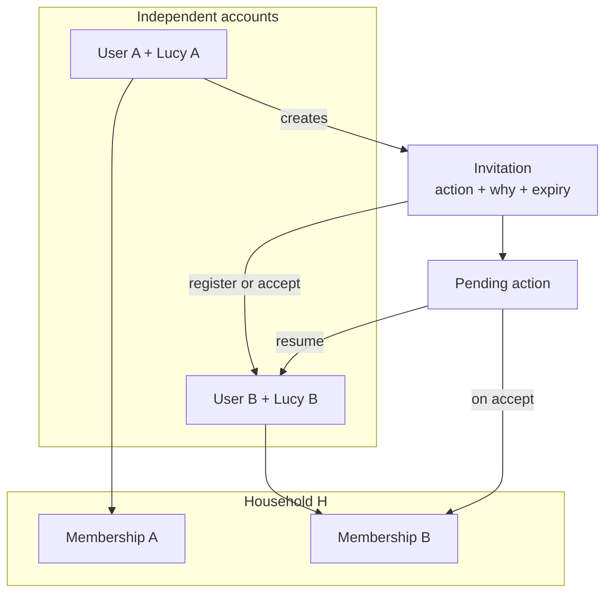

# Lucy Product Discovery

**Workstream:** Product Discovery (specification only)  
**Updated:** 2026-11-14 (pilot direction corrections)  
**Scope:** Free initial pilot · ~20 users  
**Status:** Specification for review — **no implementation performed**

## How to read this document

| Label | Meaning |
|-------|---------|
| **Established decision** | Agreed product rule for the pilot |
| **Current implementation** | What Official1 does today (evidence only) |
| **Recommendation** | Proposed target behavior |
| **Open decision** | Still needs your explicit choice |

Current code is **evidence**, not the product specification.

---

## 1. Product vision and principles

### Vision (recommendation)

Lucy is a household digital colleague that helps people **act together**: remember, share, nudge, coordinate, and follow through — primarily on WhatsApp. Growth comes from **contextual invitations into real work**, not marketing referral links.

### Principles

| # | Principle | Status |
|---|-----------|--------|
| P1 | Invitations are **contextual** (specific action + why) | **Established decision** |
| P2 | Invitees **register before** participating | **Established decision** |
| P3 | **No restricted guest mode** — no view-only outsider shell as the product path | **Established decision** |
| P4 | Every person has their **own independent Lucy account** | **Established decision** |
| P5 | **Pilot / trial users get full Lucy capabilities** | **Established decision** |
| P6 | Initial pilot is **free** (~20 users); access is duration/status based, not feature-gated | **Established decision** |
| P7 | Support **basic pilot access status and lifecycle** (active / expired / return) | **Established decision** |
| P8 | **No billing, Stripe, pricing, or payment flows** in this phase | **Established decision** |
| P9 | Keep future monetization **architecturally possible**; do **not** decide per-user vs household pricing yet | **Established decision** |
| P10 | Assign ≠ share ≠ first-come-first-served | **Recommendation** (matches today’s ACTION semantics) |

---

## 2. Pilot definition (agreed direction)

| Topic | Decision |
|-------|----------|
| Size | ~20 users |
| Cost to users | **Free** for the pilot |
| Capabilities | **Full** Lucy product surface available to pilot users |
| Accounts | **Independent account per person** |
| Guests | **Not** used as a participation mode |
| Monetization now | **Out of scope** (no plans, checkout, or payment UX) |
| Lifecycle now | Pilot **access status** (e.g. active / expired) + invitation lifecycle |
| Future paid model | Deferred; avoid hard-wiring assumptions that force per-user *or* per-household billing |

### Essential pilot journeys

1. Contextual invite → register (own account) → resume action.  
2. Two independent accounts collaborate (share / assign / nudge).  
3. Existing Lucy user accepts an invite into another household’s action.  
4. Pilot access expires → clear messaging; data retained; return restores access (**Open decision** on exact expiry policy).

### Explicitly deferred

- Stripe / subscriptions / pricing pages  
- Grocery end-to-end ordering  
- Google Drive  
- Broad Gmail access (Gmail/Calendar remain product-important; timing still open — see §7)

---

## 3. Identity, household membership, invitation, and action resumption

This section is the **required target model** for the free pilot.

### 3.1 Concepts (recommendation)

| Concept | Definition |
|---------|------------|
| **Account (User)** | Independent Lucy identity for one person (phone-anchored for WhatsApp). Owns personal data and Lucy digital worker. |
| **Household** | A collaboration boundary linking multiple accounts (membership + roles). **Not** “everyone lives under inviter’s User row.” |
| **Membership** | Account ↔ household link with status (active / left / removed) and role (**Open decision:** owner vs member naming). |
| **Invitation** | Durable object: inviter account, recipient phone (or account id if known), action kind, action context, human “why,” expiry, status. |
| **Pending action** | Server-held work to apply **after** the recipient is an active independent account (open job, share membership, assignment, meeting ask, etc.). |
| **Pilot access** | Account-level status: `active` \| `expired` (names illustrative). Full capabilities while `active`. |

**Architectural note (future monetization):** Store **entitlement/access status on the account** (and optionally later on membership). Do not embed “paid plan type” into invitation or list schemas now. That leaves per-user vs household billing undecided.

### 3.2 Scenario analysis

#### 1) New person registering from an invitation

| Step | Required behavior |
|------|-------------------|
| Receive | Contextual WhatsApp (or equivalent): who invited, what action, why, CTA to start with Lucy |
| Before register | **Cannot** mutate shared data or answer the job as a guest; may only complete registration |
| Register | Creates **new independent account** + personal Lucy; sets pilot access `active`; binds verified phone |
| Activate | Consume/link invitation; create household membership if needed; **resume pending action** |
| Notify | Inviter learns recipient joined and action proceeded |

**Current implementation gap:** registration **promotes onto the asker’s User/team** (`New Registered 30 days`), not a new User. See §8.

#### 2) Existing Lucy user receiving an invitation

| Step | Required behavior |
|------|-------------------|
| Match | Resolve recipient by verified phone → existing account |
| Present | Lucy (on recipient’s account) surfaces pending invite + context |
| Accept | Add/ensure membership; apply pending action; no second account |
| Decline | Invite `declined`; inviter notified; no membership change |

**Current implementation gap:** cold-invite path assumes guest-on-asker-account; weak “already has Lucy” first-class flow.

#### 3) Multiple invitations

| Case | Required behavior |
|------|-------------------|
| Same inviter, several actions | One account; multiple pending invites or one invite with multiple action hooks (**Open decision**) |
| Several inviters / households | Independent invites; accepting A does not auto-accept B |
| Duplicate same action | Idempotent: supersede or coalesce duplicates |

#### 4) Multiple households (if supported)

| Topic | Recommendation |
|-------|----------------|
| Support in pilot? | **Open decision** — technically valuable; UX complexity |
| If yes | Account retains one identity; memberships to many households; Lucy must disambiguate “which household” when acting |
| If no for pilot | Cap: one primary household membership; further invites create **pending** until product allows multi-home |

**Current implementation:** cross-account share/assign via contact phone → global `Employee` already exists for **registered non-guests**, but identity is not “one User, many households” as a first-class model.

#### 5) Accept / decline / expire

| Outcome | Required behavior |
|---------|-------------------|
| **Accept** | Membership + action resumption; invite `accepted`/`consumed` |
| **Decline** | Invite `declined`; no data share; inviter notified |
| **Expire** | Invite `expired`; recipient can request re-invite; pending action cancelled or marked stale; inviter notified |

**Current implementation:** `WhatsAppInvite.status` ∈ `pending | consumed | expired` (schema). Decline UX and multi-action kinds beyond cold check/send are incomplete for the target product.

#### 6) Pilot access expires while shared work is active

| Topic | Required behavior (recommendation) |
|-------|--------------------------------------|
| Capabilities | While `expired`: block **new** Lucy-powered actions from that account (sends, new jobs, new invites) |
| Shared data | **Retain** lists/memberships/history — do not wipe |
| Active jobs | **Open decision:** grace (e.g. still answer open nudges for N days) vs hard stop |
| Partners | Other active household members keep working; they see that the person is unavailable if relevant |
| Return | Operator/process restores `active` for free pilot (no payment flow); full context resumes |

**Architectural note:** Expiry is an **access flag**, not deletion. That keeps future paid reactivation simple without choosing pricing now.

### 3.3 Recommended target identity / invitation model (summary)

1. **Account** is the unit of identity and pilot access.  
2. **Household membership** is the unit of collaboration.  
3. **Invitation** carries action context; it never grants participation without registration/accept.  
4. **Pending action** resumes only after the recipient is an independent active account.  
5. **No guest participation path** in the product.

---

## 4. Action-based invitations (pilot)

### Intent types (keep distinct)

| Intent | After accept |
|--------|----------------|
| **Assign** | Responsibility on recipient’s book |
| **Share** | Co-visibility / co-mutate per list rules |
| **Tell / ask / nudge** | Job or message thread expecting reply |
| **Coordinate** | Meeting / slot flow |
| **Event prep** | Event collection membership |
| **FCFS** | First accepter wins — **Open decision** if in pilot |

### Minimum pilot invite kinds (recommendation)

1. Nudge / check-with question  
2. Share list or item  
3. Assign responsibility  

Meetings/events: **P1** if time allows. FCFS / grocery: later.

---

## 5. Google integration (unchanged strategic stance)

- **Current:** Places/Routes only.  
- **Product-important:** Gmail (narrow, consented) + Calendar.  
- **Drive:** later.  
- **Open decision:** include in free pilot wave 1 vs wave 2.  
- Do not assume broad mailbox access.

---

## 6. Grocery ordering (strategic, non-blocking)

- Lucy: matching, cart, substitutions, approval.  
- Retailer site/app: address, slot, payment.  
- Lucy marks complete only after real confirmation.  
- **Do not block** the free 20-user pilot.

---

## 7. Success for the free pilot (recommendation)

| Signal | Meaning |
|--------|---------|
| Invite → register ≤ 72h | Activation |
| Shared action completed | Invitation quality |
| WAU / actions per week | Engagement |
| D7 / D14 return | Retention |
| Access expiry handled without data loss panic | Lifecycle quality |

Conversion-to-paid metrics are **out of scope** until monetization is a project.

---

## 8. Gap analysis: current implementation vs required behavior

### 8.1 Comparison table

| Required (pilot product) | Current implementation | Gap |
|--------------------------|------------------------|-----|
| Independent account per person | Guest/register promotes **onto asker’s User**; team `New Registered 30 days`; no new `User` | **Critical** — wrong identity topology |
| No restricted guest mode | `isGuest` shells + **לוסי-אורח**; view-only shares; mutations blocked | **Critical** — conflicts with P3 |
| Register before participate | Partially true for cold invite (register-first on לוסי-אורח) | **Partial** — still via guest shell on host |
| Contextual invitations | Cold invite: ask summary + draft; mainly **send/check when no 24h session** | **Partial** — not general assign/share/meet invite product |
| Full capabilities for pilot users | Full Lucy for normal accounts; guests restricted | **Mismatch** for invitees until promote; then host-seat not own account |
| Pilot access status lifecycle | No account-level pilot `active`/`expired` entitlement | **Missing** |
| Decline invitation | Status model has pending/consumed/expired; decline UX not a first-class product flow | **Missing / weak** |
| Existing Lucy user invited | Not first-class; path oriented to new guest on asker account | **Missing** |
| Multi-invite / multi-household | Cross-account share via contacts phone→Employee exists for registered non-guests | **Partial** — no household membership entity |
| Expire access, retain data | No pilot expiry | **Missing** |
| No billing in this phase | No Stripe/subscription in product code | **Aligned** |
| Future monetization flexible | Access not modeled; risk of later bolting plans onto User vs Team ad hoc | **Need entitlement abstraction** |

### 8.2 Relevant code paths (evidence)

| Area | Paths |
|------|--------|
| Guest Lucy | `backend/src/services/employee.service.ts` (`ensureGuestLucy`), `chat.service.ts` (guest mode / PENDING_INVITE) |
| Register | `backend/src/services/guest-register.service.ts` — in-place promote on host |
| Cold invite | `backend/src/services/whatsapp-invite.service.ts`, `whatsapp.service.ts`, `whatsapp-send.ts` |
| Schema | `prisma/schema.prisma` — `User`, `Team`, `Employee.isGuest`, `shareMirrorEmployeeId`, `WhatsAppInvite` |
| Share/assign | `employee-targets.service.ts`, `LLM.config.json` ASSIGN/SHARE/TELL rules |
| Jobs / nudges | `jobs.service.ts`, `OPEN_JOBS` rules in `chat.service.ts` |
| Docs | `docs/features.md` §17–18, `docs/future-considerations.md` |

### 8.3 Relevant tests (evidence)

| Test | Covers |
|------|--------|
| `backend/tests/guest-register.test.ts` | In-place host promotion |
| `backend/tests/whatsapp-invite.test.ts` | Cold invite create, guest attach, PENDING_INVITE formatting |
| `backend/tests/team.test.ts` | Guest create without team; non-guest team |
| `backend/tests/share-unified-sendchat-e2e.eval-db.test.ts` | Guests view-only / share e2e |
| `backend/tests/employee-targets.test.ts` | Cold invite / targeting edge cases |
| `backend/tests/q1-instructions-baseline.eval-db.test.ts` | Guest instruction baseline |
| `backend/tests/tips.test.ts` | לוסי-אורח tip wiring |

### 8.4 Recommended target vs rewrite pressure

| Layer | Recommendation |
|-------|----------------|
| **Keep** | ACTION semantics (lists, jobs, share/assign/tell), WhatsApp chat pipeline, reminder/job engines |
| **Replace / redesign** | Guest participation path; register → host seat; invite only for cold Graph session |
| **Add** | Independent User provisioning; household membership; general Invite + PendingAction; account `pilotAccessStatus`; accept/decline; resume hooks |

---

## 9. Proposed implementation phases (not started)

| Phase | Scope | Depends on |
|-------|--------|------------|
| **P0a — Product lock** | Resolve open decisions in §10 that block identity | Your review |
| **P0b — Identity foundation** | Create-own-User registration; phone uniqueness; pilot access status field; stop using guest as participation | P0a |
| **P0c — Invitation v2** | Contextual invite object for nudge/share/assign; accept/decline/expire; pending action store | P0b |
| **P0d — Action resumption** | On accept: open job / attach share / assign item; notify inviter | P0c |
| **P0e — Existing-user invite** | Phone match → surface on recipient Lucy; no duplicate User | P0c |
| **P1 — Household membership** | Explicit membership model; optional multi-household | P0b–d |
| **P1 — Access expiry** | Expire pilot access; retain data; operator restore | P0b |
| **P2 — Google** | Calendar + narrow Gmail if chosen for pilot | Infra + consent UX |
| **Later** | Monetization entitlements mapping; grocery | Explicit new workstream |

**Dependency on Infrastructure Discovery:** reliable always-on host + DB backups before promising expiry/return and multi-user invites at pilot scale (`docs/infra/lucy-infrastructure-discovery.md`).

---

## 10. Open decisions that still need your input

Only items that are **not** already settled by this update:

### Identity & household
1. **Multi-household in the free pilot?** Yes / no / “pending invites only.”  
2. **Household roles:** owner vs member (and who can invite)?  
3. **Registration fields** beyond name + gender (email? password now or WhatsApp-only)?  

### Invitations
4. **Invite expiry default** (7 / 14 / 30 days)?  
5. **One invite record per action vs bundle** multiple pending actions?  
6. **FCFS** in pilot or not?  
7. Pilot v1 invite kinds: confirm nudge + share + assign only?  

### Access lifecycle (still free — no payment)
8. **Pilot duration** per user (calendar end date vs N days from register)?  
9. **On expiry:** hard stop vs grace for open jobs?  
10. **Who restores access** for the free pilot (you manually / allowlist / auto)?  
11. **Data retention** if user never returns (keep forever vs soft-delete after M months)?  

### Google / grocery / brand
12. Google in wave 1 or 2?  
13. Grocery deferred — confirm?  
14. Invite brand copy: **Lucy** vs **Workee**?  

### Explicitly not to decide now
- Per-user vs household **pricing**  
- Stripe/plans/checkout  
- Paid conversion funnels  

---

## 11. Prioritized roadmap (product)

| Priority | Outcome |
|----------|---------|
| **P0** | Independent accounts + contextual invite + register-before-act + action resume |
| **P0** | Remove product reliance on restricted guest participation |
| **P0** | Pilot access status (active/expired) without billing |
| **P1** | Household membership clarity; expiry/return ops |
| **P2** | Google Calendar + narrow Gmail |
| **P3** | Grocery integration; future monetization mapping |

---

## 12. Cross-references

- Infra: `docs/infra/lucy-infrastructure-discovery.md`  
- Current feature evidence: `docs/features.md` §17–18, `docs/future-considerations.md`  

---

*End of updated product discovery. No code or database changes. Stop for review.*
